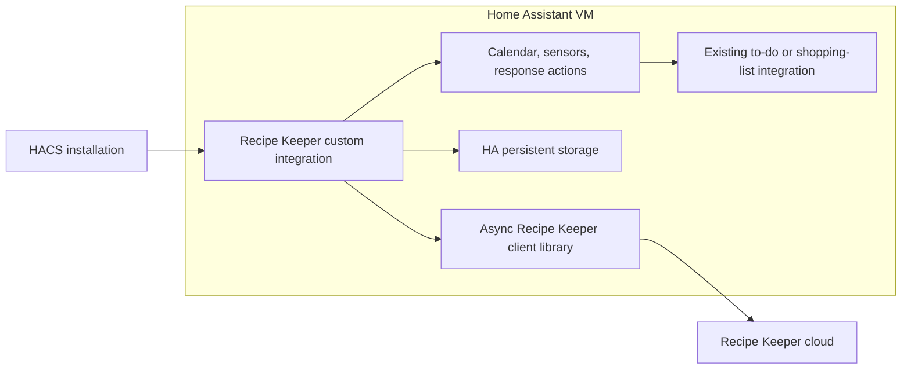

# HACS and native Home Assistant feasibility

**Yes: a HACS custom integration can run the Recipe Keeper cloud connection
inside Home Assistant in the VM. A separate API server, Docker deployment, or
Supervisor app is not required for this architecture.** The direct cloud path
was verified with an isolated Home Assistant development runtime on 2026-10-19.
An installable HACS integration is the next implementation stage; this project
does not contain a completed custom component yet.

## Evidence from the Home Assistant runtime

`scripts/probe_home_assistant_runtime.py` used the real Home Assistant runtime
and its shared aiohttp session to log in and download the account's data. It
did not import the FastAPI service or access the Mac's app database/session.
The locally configured credentials file supplied credentials to this test only.

| Runtime check | Result |
| --- | --- |
| Fresh login using HA's shared HTTP session | Succeeded |
| Active recipes | 72 |
| Meals converted to native `CalendarEvent` objects | 55 |
| Private HA `Store` save and disk reload | Matched |
| Response action returning recipe search results | 72 results |
| Response action returning ingredients and directions | Succeeded |
| Entities uploaded to Recipe Keeper | 0 |
| External API server used | No |

The test ran against the local Core checkout, version `2026.11.0.dev0`, on
Python 3.14.8. It created its own isolated HA object and configuration directory,
not a connection to the running home's instance. It did not install HACS, add a
calendar entity to the live VM, or change any existing shopping lists. Target VM
version compatibility, full config-flow lifecycle, and HACS installation remain
release validation steps. The minimum supported HA version is not established
by this proof.

To reproduce with the existing HA development environment:

```sh
cd /Users/ryantrapp/Code/recipe_assistant_api
/Users/ryantrapp/Code/core/.venv/bin/python3 scripts/probe_home_assistant_runtime.py
```

The test cache is private and Git-ignored under
`local-data/ha-feasibility/.storage/`. It contains recipes and cursors, with
photos and authentication tokens excluded. The script reports only aggregate
results. It is a development harness, not something to copy into a running HA
installation. Subsequent runs can use its saved cursors.

## Recommended architecture



HACS distributes custom integration files into Home Assistant's
`custom_components` directory. The integration executes within HA. Supervisor
apps, formerly add-ons, are separate applications alongside HA; they are a
different packaging mechanism. A cloud client does not require one.
[HACS installation location](https://www.hacs.xyz/docs/use/repositories/type/integration/),
[Home Assistant apps](https://www.home-assistant.io/apps/).

Use one shared cloud client and fixed five-minute polling through a
`DataUpdateCoordinator`. Reuse `async_get_clientsession(hass)`, preserve the
existing one-reauthentication retry behavior, and raise `ConfigEntryAuthFailed`
after persistent credential rejection. A config flow provides account setup
and reauthentication. The integration should remain a thin wrapper around a
separate, versioned Python client library.
[Fetching data](https://contributors.home-assistant.io/core/integrations/fetching-data/).

Use HA's `Store` for a versioned snapshot of recipes, meals, exact cursor strings,
sync metadata, and any shopping-list import ledger. Commit the complete new
snapshot only after every page succeeds. Keep credentials in config-entry data
and tokens in memory; redact credentials and recipe content from diagnostics.
Cache keys should be isolated per config entry/account.

On cloud failure, preserve the cache, expose stale status, and prevent automatic
shopping imports from treating old data as current. Cached read actions may
still return data with explicit freshness metadata. Coordinator entities should
follow HA availability rules; returning cached data must not disguise a failed
refresh. Authentication failures should start HA's reauth flow rather than
repeatedly attempting the same bad password.

## How to expose the requested features

These names describe the proposed integration, not actions already installed.

| Feature | Native HA representation |
| --- | --- |
| Meal plan | Read-only calendar entity with stable meal IDs and calendar dates |
| Recipe search | `recipe_keeper.search_recipes` response action |
| Full recipe contents | `recipe_keeper.get_recipe` response action |
| Recipe/meal counts | Small sensor entities |
| Cache freshness | Last-successful-sync sensor and stale/connectivity status |
| Ingredient preview | `recipe_keeper.preview_ingredients` response action |
| Shopping-list automation | Call an existing list's `todo.add_item` action from an explicit import action or automation |

HA supports actions that return structured response data, including search
results. This keeps the recipe collection out of entity states and large
recorder attributes. A recipe browsing dashboard can be added separately;
response actions alone do not create a finished recipe browser UI.
[Response actions](https://contributors.home-assistant.io/core/integrations/actions/).

Ingredient review must support a selected subset, with pantry staples such as
olive oil unselected by default and per-shop overrides. The shared backend
selection logic is implemented; see [ingredient selection](shopping-selection.md).
The custom integration's review UI and actual shopping-list writer remain to build.

The native to-do building block already provides item creation and retrieval
for compatible list integrations. We can use it instead of building another
list provider. Shopping-list import still needs implementation: persist imported
line keys, handle partial success and changed meals, and retain the existing
review requirements for ambiguous recipe titles and serving scales. Read-only
cloud sync does not imply permission or protocol support for writing to Recipe
Keeper's own shopping lists.
[To-do integration](https://www.home-assistant.io/integrations/todo/).

The Platinum Mealie integration in the local Core checkout is a relevant
reference: it uses an injected async client, coordinators, calendar/sensor/to-do
platforms, and response actions. It demonstrates the HA-side patterns without
requiring Recipe Keeper to become a separate local web service.

## What needs adapting from the current project

The protocol, cursor handling, tombstones, date mapping, matching rules, and
401 retry behavior are reusable. The standalone service is not a drop-in HA
integration:

- Replace blocking urllib networking with an async client using HA's session.
  Blocking network/disk work must not run on HA's event loop. The runtime proof
  also moves large response parsing into HA's executor.
- Replace the standalone worker thread and CLI credential files with the HA
  coordinator and config flow. Do not run Uvicorn inside an integration.
- Replace the standalone SQLite cache and its file locking with the HA storage
  adapter, keeping all sync state updates atomic.
- Extract a small client package with no FastAPI/Uvicorn dependency. Declare its
  exact version in the integration manifest. Publish a distributable library
  before release; local editable installation is suitable during development.

[Blocking operations](https://contributors.home-assistant.io/core/internals/blocking-operations/),
[Manifest requirements](https://contributors.home-assistant.io/core/integrations/manifest/).

HACS does not copy the repository's `src/recipe_assistant` directory into the
integration folder. A component that imports that sibling source tree would
fail after installation. The installed component must contain its integration
files and declare installable external dependencies.

## HACS distribution readiness

The user-provided [HACS integration requirements](https://www.hacs.xyz/docs/publish/integration/)
require one integration folder under `custom_components`, a manifest with domain,
name, version, documentation, issue tracker, and codeowners, and brand assets.
Use a root `hacs.json`; the component's current brand location is
`custom_components/recipe_keeper/brand/icon.png`.
[Custom integration images](https://contributors.home-assistant.io/core/integrations/brands/).

Proposed layout:

```text
hacs.json
custom_components/
  recipe_keeper/
    __init__.py
    manifest.json
    config_flow.py
    const.py
    coordinator.py
    calendar.py
    sensor.py
    binary_sensor.py
    services.py
    services.yaml
    strings.json
    translations/en.json
    diagnostics.py
    brand/icon.png
```

Read-only GitHub inspection found the existing repository
`ryantrappy/recipe_keeper_ha_integration` is **private**, with no description or
topics. HACS's current general requirements specify public GitHub repositories
and repository metadata. Visibility and metadata must be addressed before HACS
distribution; no repository visibility was changed by this investigation.
Private development and a manual custom-component install remain possible.
[HACS general requirements](https://www.hacs.xyz/docs/publish/start/).

## Next implementation and validation gates

1. Extract and test the independent async client, including bounded 401 renewal,
   pagination, rate limits, malformed responses, and cancellation.
2. Build config flow/reauth, one coordinator, HA storage, and unload cleanup.
3. Add the read-only calendar, compact sensors, and recipe response actions.
4. Add reviewed ingredient import to a selected existing to-do list, with
   duplicate prevention and explicit stale-data handling.
5. Package the client dependency and HACS files. Validate with hassfest and the
   HACS action; test through HA's config entries and services.
6. Test on the actual VM's HA version, install from the distribution repository,
   restart offline, restore online, force a 401, unload/reload, and upgrade.

The API bridge can remain available for other clients or as an optional future
transport. A separate Docker/API deployment adds another running service and
network credential to maintain; it is a fallback architecture, not a technical
requirement for the native cloud integration.
