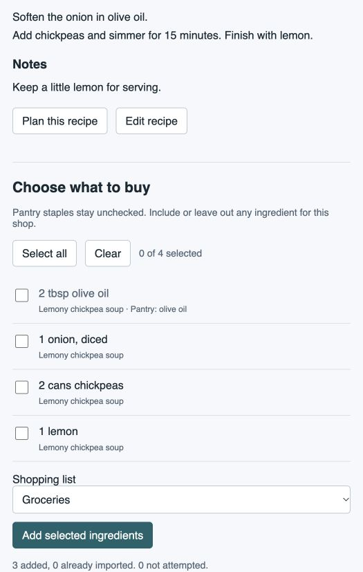

# Recipe Keeper in Home Assistant

The integration includes a native custom component and sidebar panel. It runs inside
your Home Assistant VM, logs in directly to Recipe Keeper, and polls every five
minutes. Your Mac and the standalone API on trappserv.er do not need to be running.
It uses the same persistent sync/edit engine as the API, with Home Assistant's
shared aiohttp session. No Docker service, Mac database mount, or REST sensor setup
is required.

The minimum/tested Home Assistant version is **2026.10.2**, matching your VM's Core
version. The integration has been tested in an isolated runtime of that exact
version; it has not yet been installed in your production VM.

## HACS installation

The repository is public. Use the [HACS button and steps in the README](../README.md#installation-hacs).
The native integration is available on `main`. HACS installs the component directly
from the repository/release; a separate API container is not needed. The ZIP below
is an alternative for manual installation.

## Manual development installation

1. Create a Home Assistant backup. If upgrading this integration, include its
   private `.storage/recipe_keeper*` files and integration configuration in that backup.
2. Build the ZIP on your Mac:
   ```sh
   cd /path/to/recipe_keeper_ha_integration
   uv sync --locked
   uv run python scripts/build_distributions.py
   ```
3. Copy `dist/recipe_keeper-0.2.1.zip` to the VM using your existing file access.
   Extract it **inside `/config`**. It must produce
   `/config/custom_components/recipe_keeper/manifest.json`, not another nested
   `custom_components` directory. Copying the source's entire
   `custom_components/recipe_keeper` folder to `/config/custom_components/` is equivalent.
4. Restart Home Assistant. Go to **Settings → Devices & services → Add integration
   → Recipe Keeper**. Sign in with your Recipe Keeper email and password.
5. Open **Recipe Keeper** in the sidebar. If it is missing after installation,
   reload the browser page and check the integration's setup logs.

Only the component folder is needed in HA. The ZIP includes its Python client,
translations, panel JavaScript, and original book icon. It contains no account
credentials, database, recipe backup, API server, or tests. Home Assistant resolves
the declared pydantic dependency using its existing compatible installation.

## HACS distribution

The component follows the [HACS integration layout](https://www.hacs.xyz/docs/publish/integration/):
one domain under `custom_components`, all runtime code inside that folder,
`manifest.json`, `hacs.json`, and a local `brand/icon.png`. The workflow validates
HA metadata, runs regression tests, and builds installation artifacts. Its HACS
distribution validation job runs when the repository is public.

The repository is public and the native integration is available through `main`
and versioned GitHub releases. The project is [MIT-licensed](../LICENSE); its license
is included in the component and Python client distributions. Default-store
inclusion is a separate submission; a custom repository does not require it.

## Configure

Under **Devices & services → Recipe Keeper → Configure**:

- **Allow editing Recipe Keeper** defaults **off**. Turn it on only when you want
  HA actions and the panel to create, update, or delete cloud recipes/meal records.
  Disabling it closes/reloads the client and blocks subsequent uploads. A request
  already sent to Recipe Keeper can still finish and must be reconciled.
- **Pantry staples** accepts one ingredient name per line, for example `olive oil`,
  `salt`, and `black pepper`. Matching ignores case, quantities, and common units.
  Staples remain visible but unchecked; explicitly check one when you need to buy it.
- **Default shopping list** selects any HA `todo` entity supporting add-item.
  You can choose another list for each import.

Cloud credentials live in HA's integration configuration, not this repository.
They are needed for fresh sign-in when a session expires; protect HA backups as you
would other integration credentials. Tokens remain in memory. Recipe snapshots,
full pre-edit records, and the operation journal live in the component's private
`.storage/recipe_keeper_<entry-id>.db` SQLite file. Import receipts live in
`.storage/recipe_keeper.<entry-id>.imports`. These contain private data. Keep the
journal/receipts when upgrading: removing them loses recovery/deduplication history.
Removing and re-adding an account creates a new entry and new history. No files are
automatically deleted on removal, so old journals remain available for recovery.

## Recipes, meals, and shopping

The sidebar supports recipe/ingredient search, complete recipe text, meal-plan
browsing, and a per-ingredient checklist for the selected inclusive date range.
Check only what you need, choose a shopping list, then **Add selected ingredients**.
The importer refreshes cloud data and validates your selected stable keys again;
if ingredients changed, refresh the preview and select again. Recipe scale is shown
as context; ingredient quantities are not rewritten or merged across recipes.

A meal title must uniquely match a recipe title to supply ingredients. Missing or
ambiguous matches and unsupported linked-recipe ingredients are shown as issues.
You can explicitly acknowledge those issues and import only available selections.
Neither pantry filtering nor shopping imports changes Recipe Keeper recipes.

Import receipts prevent repeated addition of the same ingredient source key to the
same HA list, including when an import is retried with another UUID. A different
meal/ingredient revision receives a different key. Removing an item manually from
the list does not clear its receipt. To buy it again for that same meal revision,
add it manually; there is no automatic receipt reset. Existing matching list text
is not searched or merged, so manually added duplicates can exist.

On a lost service response, cancellation, crash, or disk problem, an attempted item
can be **uncertain**. Check the actual list before manually adding it. Untouched
items are **not attempted**. Repeating an import UUID returns its recorded progress;
it never replays uncertain additions or resumes an interrupted batch automatically.
Automation responses include `added_keys`, `skipped_keys`, `uncertain_keys`, and
`not_attempted_keys`. You may submit a fresh UUID with only the reviewed,
not-attempted keys. Uncertain markers continue to block automatic re-addition.

The meal calendar exposes all-day events in HA's timezone, counts/status sensors,
a last-sync timestamp, and freshness/editing diagnostic binary sensors. Calendar
create/update/delete is deliberately offered through explicit Recipe Keeper actions,
not generic calendar recurrence editing. Full recipes are returned by actions and
the panel rather than stored in entity-state attributes. Diagnostics contain counts
and sync status, excluding credentials and recipe/meal contents.

## Optional two-way editing

With editing enabled, an administrator can use **New recipe**, **Edit recipe**,
**Plan meal**, **Edit meal**, or **Delete**. Updates change only the named fields;
photos, metadata, sharing information, unknown fields, and other existing fields
are preserved. Delete requires confirmation and creates a cloud deletion record.
The local Mac Recipe Keeper database is never written directly.

An update/delete requires a revision from a fresh editing view. The engine refreshes
before uploading and rejects an already changed record, records the complete
baseline and intended payload durably before sending, and verifies the result with
a separate download. Every request has an operation UUID. Unknown outcomes are held
for **Check saved edit**, including after a browser reload; only UUID/type/account
metadata is stored in browser local storage. Checking is download-only and works
with editing disabled. Never retry an unknown operation as a new UUID blindly.
Known pre-upload validation rejections leave the form correctable.

Recipe Keeper's tested endpoint **does not enforce an established compare-and-swap
revision contract**. Another device editing between preflight and upload can still
overwrite changes; post-upload verification cannot eliminate that race. Avoid
simultaneous edits to the same record. There is no bidirectional shopping-list
sync with Recipe Keeper, no photo upload editor, and no bulk-delete action.

## Actions and automations

All response actions use domain `recipe_keeper`. Select the account with its
`config_entry_id`, obtainable from `get_accounts`. Dates use `YYYY-MM-DD` and
include both ends, limited to 366 days.

| Action | Inputs in addition to account | Result |
| --- | --- | --- |
| `refresh` | None | Counts, freshness |
| `get_sync_snapshot` | None | All cached records, exact revisions, tombstones, unresolved operations; see [Skylight preparation](skylight-sync.md) |
| `search_recipes` | Optional `query`, `limit` (1–100), `offset` | Paginated recipe summaries |
| `get_recipe` | `recipe_id` | Full recipe text |
| `get_meal_plan` | `start_date`, `end_date` | Meals and recipe matches |
| `preview_ingredients` | Dates, optional `selected_keys` | Ingredients, pantry matches, issues |
| `import_ingredients` | Dates, `selected_keys`, UUID `import_id`, optional `todo_entity`, `acknowledge_issues` | Durable addition receipt |
| `get_editing_view` | `entity_type` (`recipe`/`meal`), `entity_id` | Editable fields and `revision` |
| `create_recipe` / `create_meal` | UUID `operation_id`, `changes` | Operation state/record ID |
| `update_recipe` / `update_meal` | UUID, `recipe_id`/`meal_id`, `revision`, `changes` | Operation state |
| `delete_recipe` / `delete_meal` | UUID, record ID, `revision` | Operation state |
| `get_edit_operation` / `reconcile_edit` | UUID `operation_id` | Journal state / download-only verification |

Cloud writes and shopping imports require an administrator context (or a system
context used by HA automations). Read actions use normal HA access controls. All
actions return responses, so automations need `response_variable`:

```yaml
- action: recipe_keeper.preview_ingredients
  data:
    config_entry_id: YOUR_ENTRY_ID
    start_date: "2026-10-20"
    end_date: "2026-10-26"
  response_variable: ingredients
```

An automation should inspect `stale`, `issues`, and the ingredient keys, then pass
an explicit list of keys to import. An empty list adds nothing. Configure pantry
staples once, or use the checklist for each shop. Do not automatically import an
entire preview without applying your selection policy.

## Development and recovery

```sh
uv run pytest -q
node --test frontend_tests/*.test.cjs
uv run ruff check .
uv run ruff format --check .
uv run python scripts/bundle_client.py --check
uv venv --python 3.14 local-data/ha-test
uv pip install --python local-data/ha-test/bin/python -r requirements-ha-test.txt
PYTHONPATH=. local-data/ha-test/bin/python -m pytest -c ha_tests/pytest.ini ha_tests --confcutdir=ha_tests -q
uv run python scripts/build_distributions.py
```

Canonical client code lives in `src/recipe_assistant`. `bundle_client.py` copies a
fixed module allowlist byte-for-byte into `_vendor/recipe_keeper_client`, with
SHA-256 provenance checked by CI. This keeps protocol logic out of HA adapters and
makes the ZIP self-contained without an unpublished PyPI dependency. The build also
produces an independently installable `recipe-keeper-client` wheel and source
archive, with no FastAPI/Uvicorn or Mac preference dependencies. Regenerate the
bundle after changing canonical client code. Public PyPI publication is not needed.

After credential rejection HA offers reauthentication. During cloud outages the
last complete snapshot remains available to read actions/panel, explicitly stale;
entities become unavailable and imports stop. A first setup without any snapshot
retries later. Do not remove caches/journals to repair authentication. If an import
ledger is corrupt or cannot commit to disk, imports stop before new additions;
restore the journal from your HA backup and review the actual list.

The screenshot below uses synthetic recipes and an in-memory shopping-list handler.
It demonstrates a three-item import with olive oil excluded; it is not your live HA instance.


